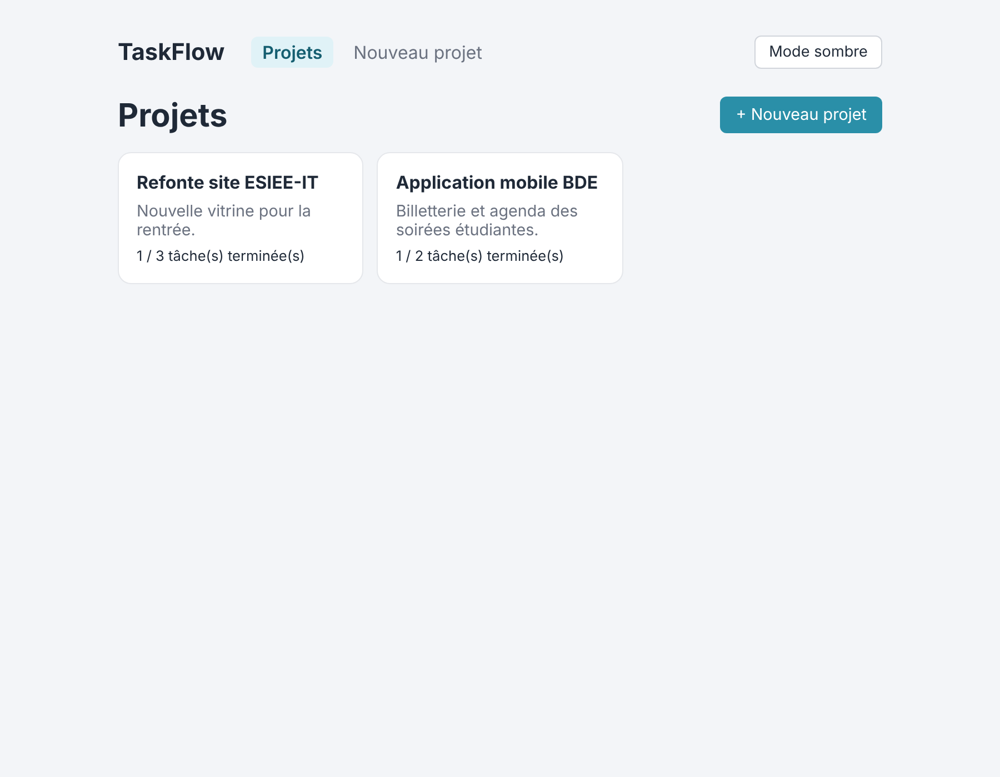
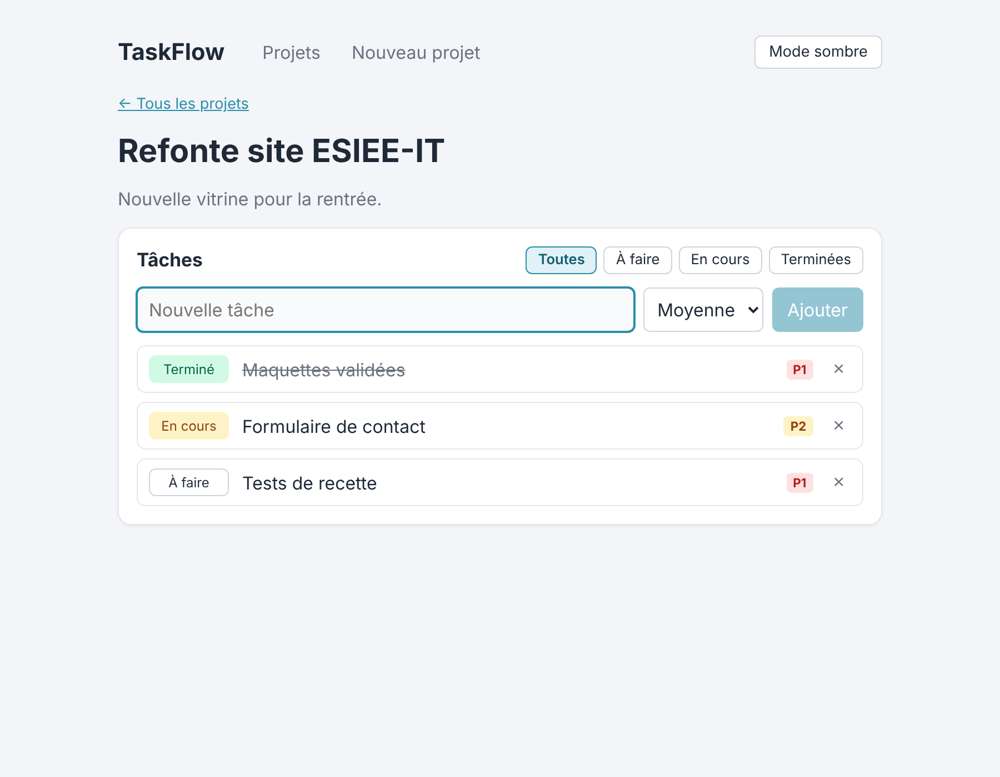
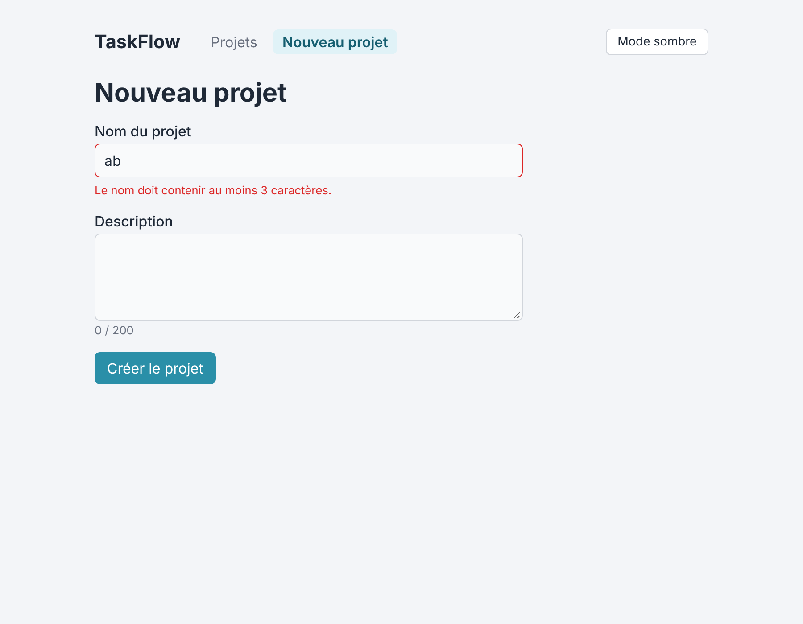
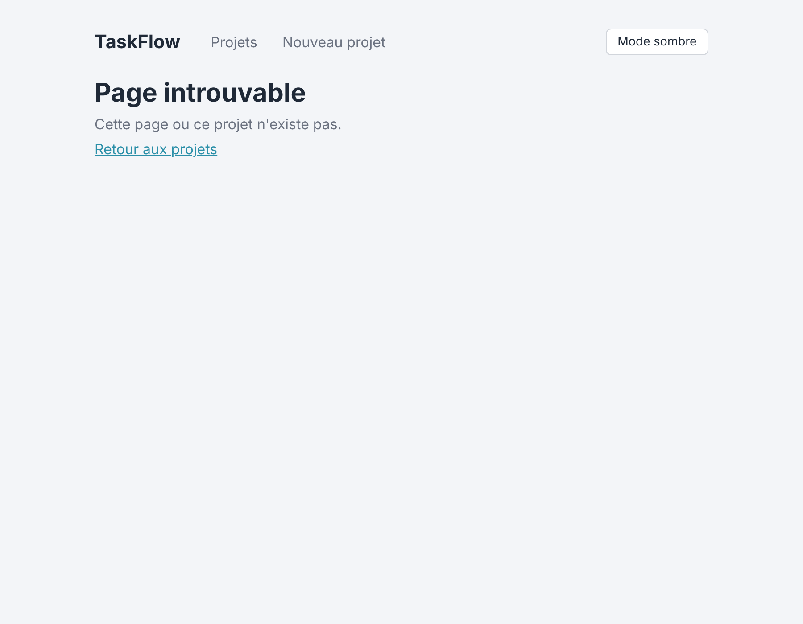
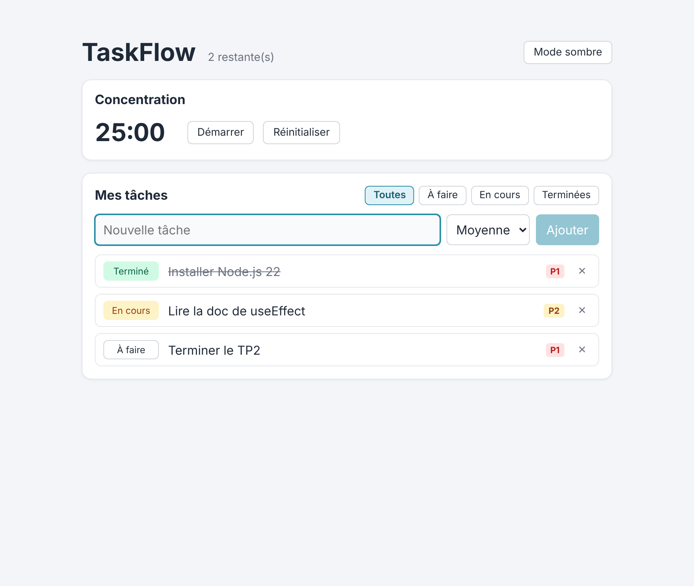
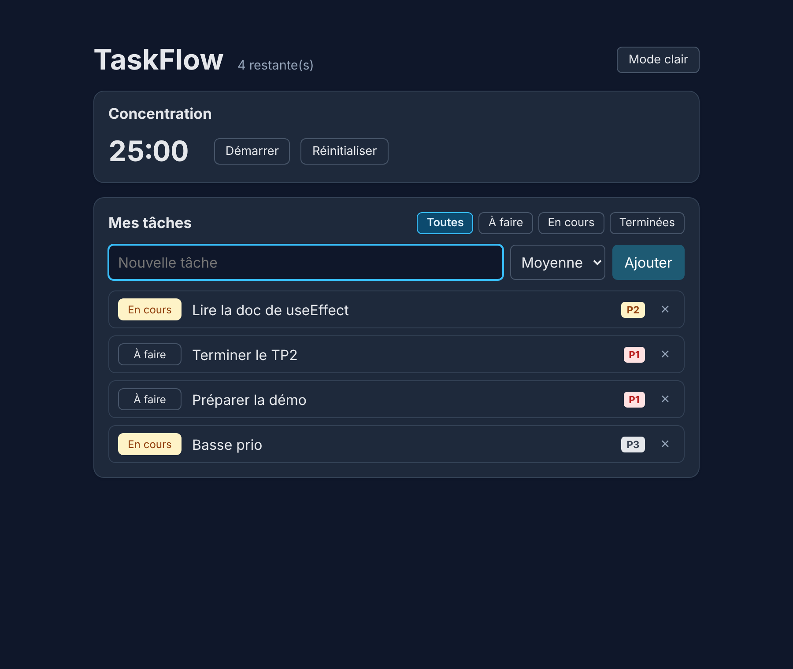
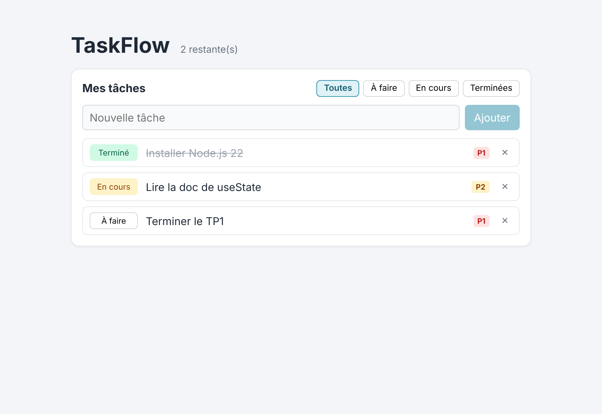

# TaskFlow

Application de gestion de tâches en React + TypeScript (Vite), construite au fil des TP.

##Lien Vercel

https://taskflow-git-tp3-taskflow-d678.vercel.app/

## TP3 — multi-pages, connecté à une API



- API REST locale avec json-server sur http://localhost:3001 (données dans `db.json`).
- Routes : `/` (projets), `/projects/new` (nouveau projet), `/projects/:id` (page d'un projet), tout le reste en 404.
- La barre de navigation (`Layout`) reste affichée ; le contenu change via `<Outlet />`.
- Page d'un projet : ajouter (POST), faire avancer (PATCH), supprimer (DELETE) une tâche, enregistré dans `db.json`.
- Formulaire de création validé (nom d'au moins 3 caractères), puis ouverture de la page du projet.
- Message d'erreur clair si l'API ne répond pas ; page « Page introuvable » pour une adresse ou un projet inconnu.

| Page d'un projet | Nouveau projet | 404 |
| --- | --- | --- |
|  |  |  |

### Déploiement

- **API sur Render** (Web Service) : build `npm install`, start `npx json-server db.json --host 0.0.0.0 --port $PORT`.
- **Site sur Vercel** : variable d'environnement `VITE_API_URL` = adresse Render (sans `/` final).
  `vercel.json` redirige toutes les adresses vers `index.html` pour que le routeur fonctionne après un rechargement.

## TP2 — persistance, minuteur et thème



- Les tâches sont enregistrées dans le `localStorage` (clé `taskflow-tasks`) grâce au hook `useLocalStorage`.
- L'onglet affiche « (n) TaskFlow », n étant le nombre de tâches non terminées.
- Le curseur est placé dans le champ à l'ouverture et après chaque ajout.
- Chaque tâche a une priorité choisie à l'ajout : Haute (P1), Moyenne (P2), Basse (P3).
- Carte « Concentration » : minuteur de 25 minutes avec Démarrer / Pause et Réinitialiser.
- Thème clair / sombre, mémorisé dans le `localStorage` (clé `taskflow-theme`).



## TP1 — liste de tâches typée



Ajouter des tâches, faire tourner leur statut (À faire → En cours → Terminé), les supprimer, les filtrer,
avec un compteur de tâches restantes.

## Lancer le projet

```bash
npm install
npm run dev      # API (http://localhost:3001) + site (http://localhost:5173)
npm run api      # API seule
npm run web      # site seul
npm run build
```

## Structure

| Fichier | Rôle |
| --- | --- |
| `db.json` | Données de l'API json-server (projets et tâches) |
| `src/api.ts` | `request()` commune et une fonction par opération de l'API |
| `src/types.ts` | Types `Status`, `Priority`, `Task`, `Project`, `Filter`, libellés, `nextStatus` |
| `src/hooks/useLocalStorage.ts` | État React synchronisé avec le `localStorage` (thème) |
| `src/context/ThemeContext.tsx` | Contexte du thème, `ThemeProvider` et hook `useTheme` |
| `src/components/Card.tsx` | Conteneur réutilisable (`title`, `actions?`, `children`) |
| `src/components/TaskForm.tsx` | Titre, priorité, validation, focus automatique |
| `src/components/FilterBar.tsx` | Quatre filtres, `aria-pressed` sur l'actif |
| `src/components/TaskItem.tsx` | Une ligne : statut cliquable, titre, priorité, bouton × |
| `src/components/TaskList.tsx` | Liste des tâches ou message si vide |
| `src/components/FocusTimer.tsx` | Minuteur de concentration (TP2, plus affiché depuis le TP3) |
| `src/components/ThemeToggle.tsx` | Bouton Mode sombre / Mode clair |
| `src/components/Layout.tsx` | Barre de navigation (`NavLink`) et `<Outlet />` |
| `src/components/Status.tsx` | Affichage du chargement ou d'une erreur |
| `src/pages/ProjectsPage.tsx` | Liste des projets |
| `src/pages/ProjectPage.tsx` | Un projet et ses tâches |
| `src/pages/NewProjectPage.tsx` | Formulaire de création de projet |
| `src/pages/NotFoundPage.tsx` | Page 404 |
| `src/App.tsx` | Déclaration des routes |
